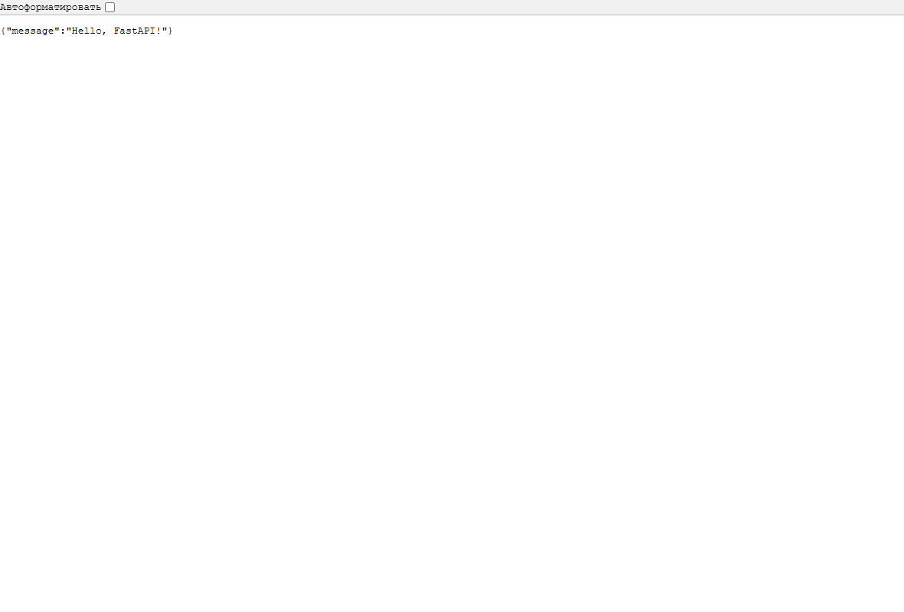
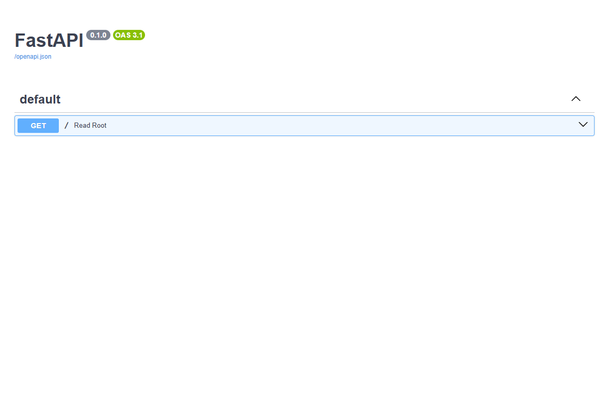
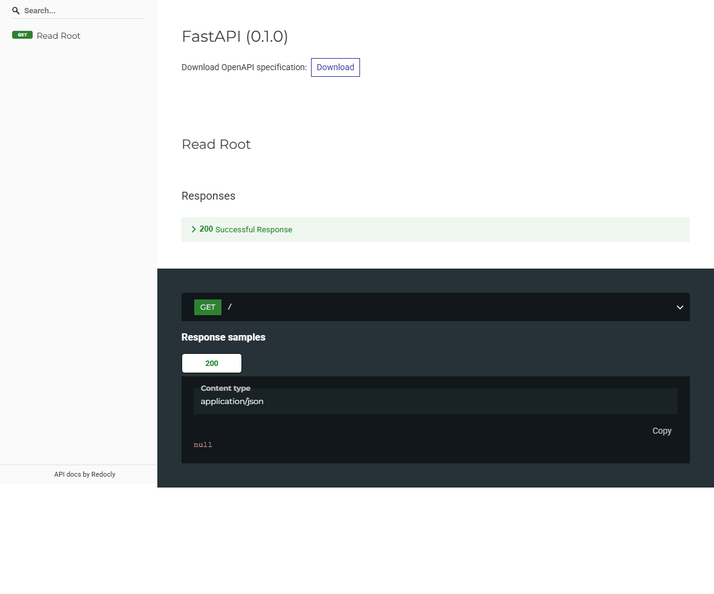
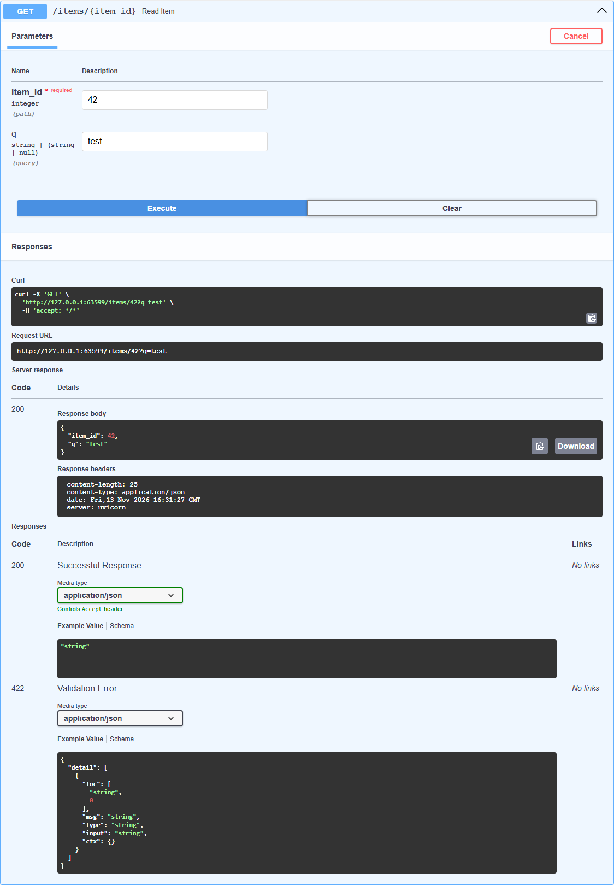
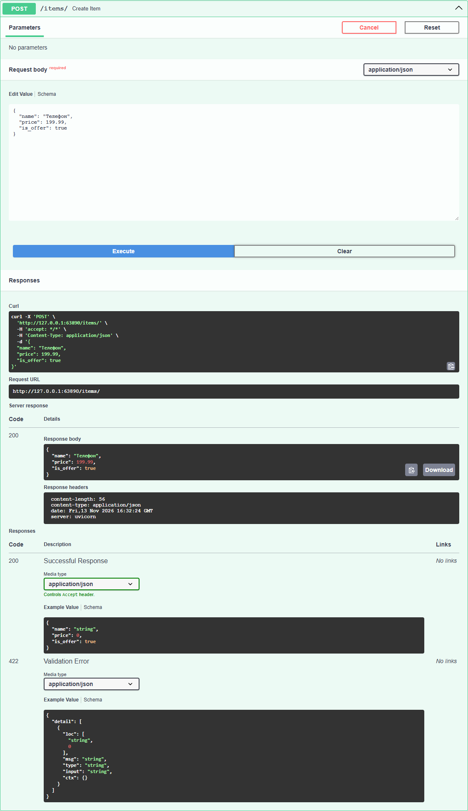
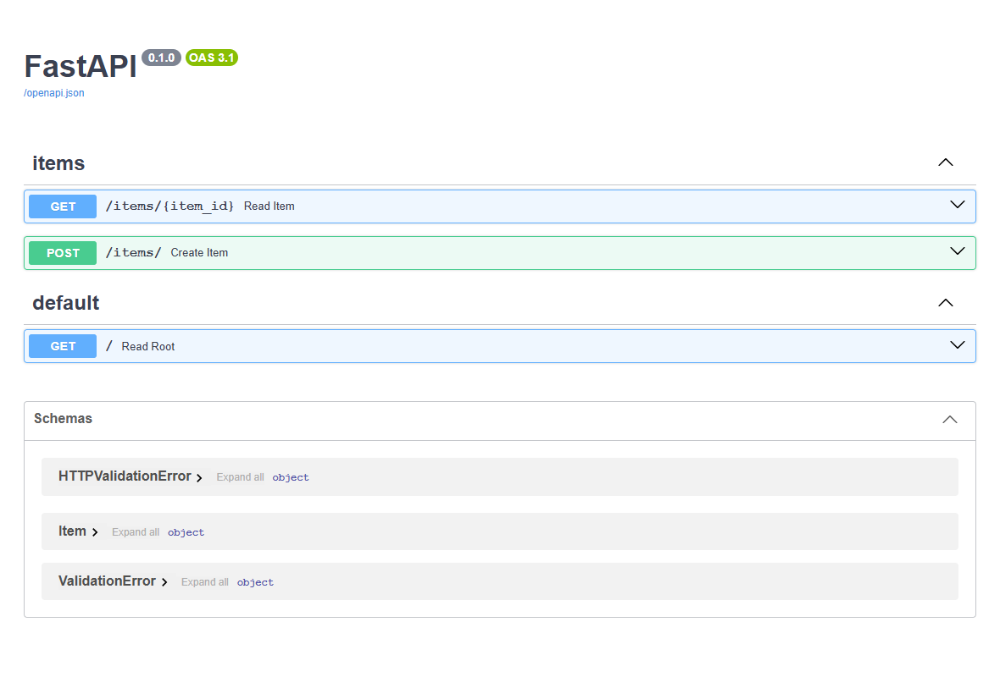
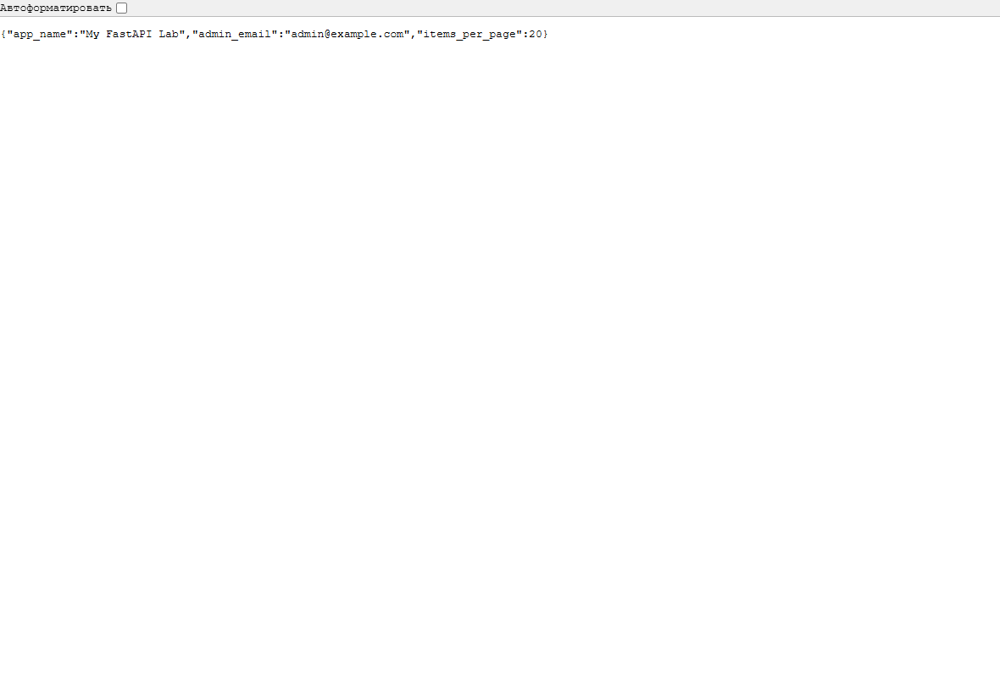
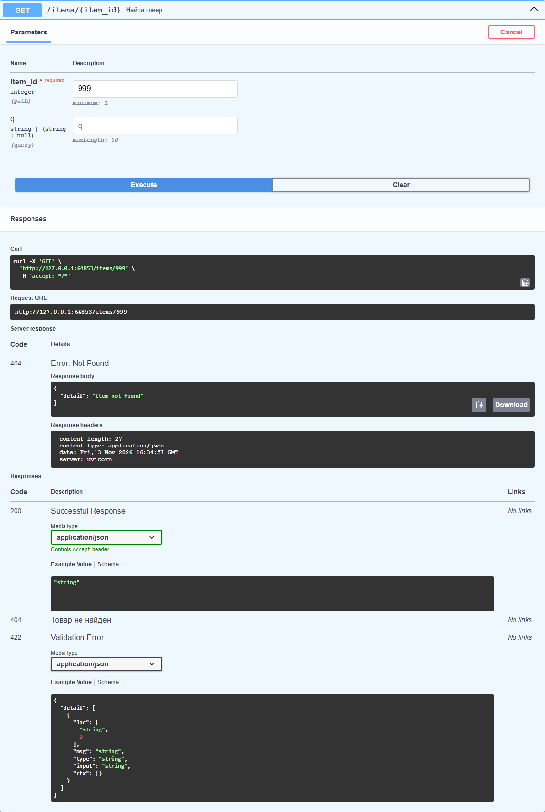
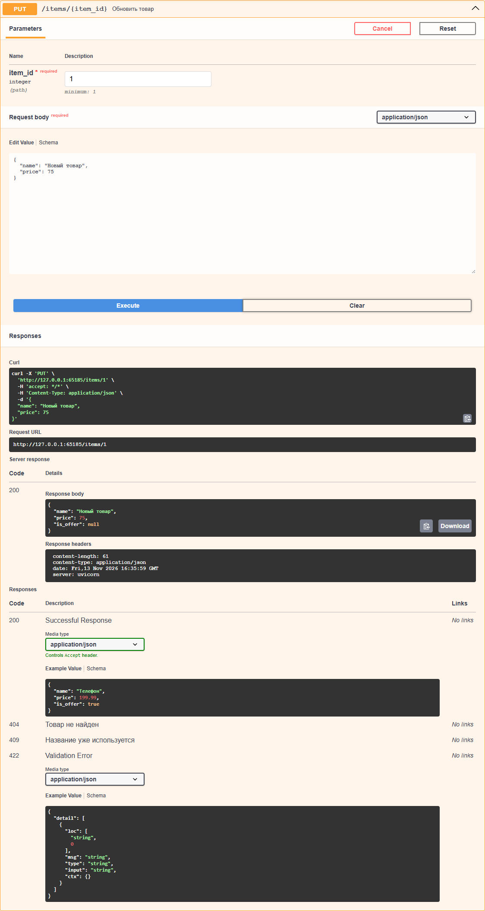
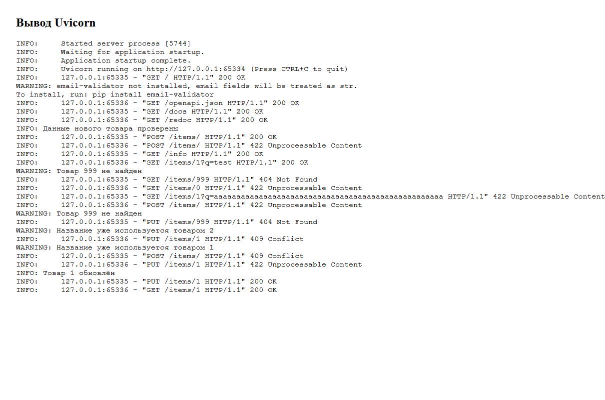

Лабораторная работа 6 по FastAPI.

Чтобы запустить проект, скопируйте `.env.example` в `.env`. Затем выполните `uv sync --locked` и `uv run uvicorn main:app --reload`. Откройте `http://127.0.0.1:8000/docs`, чтобы проверить запросы.

Запрос `GET /` возвращает приветствие. `GET /items/1?q=test` показывает товар и переданный параметр `q`. `POST /items/` проверяет данные товара и возвращает их. `PUT /items/1` обновляет товар в словаре. После перезапуска изменения пропадают.

Проверка показала, что запрос к отсутствующему товару возвращает 404, повторное имя даёт 409, а цена 0 даёт 422. Маршрут `/info` возвращает настройки из `.env`. Сообщения об обновлениях и ошибках видны в консоли.

Скриншоты сделаны по ходу работы. В первых коммитах запрос с номером 42 возвращал параметры. В готовой версии товар с таким номером не найден, поэтому для проверки GET можно взять номер 1.

